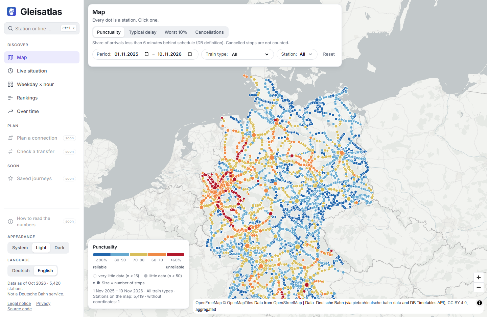
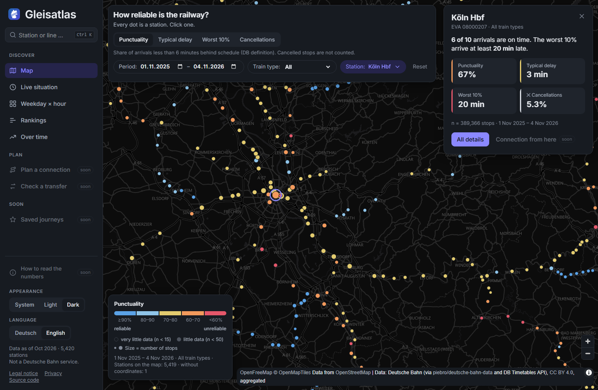
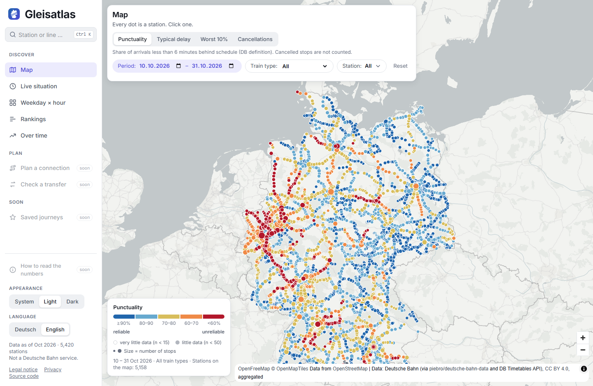
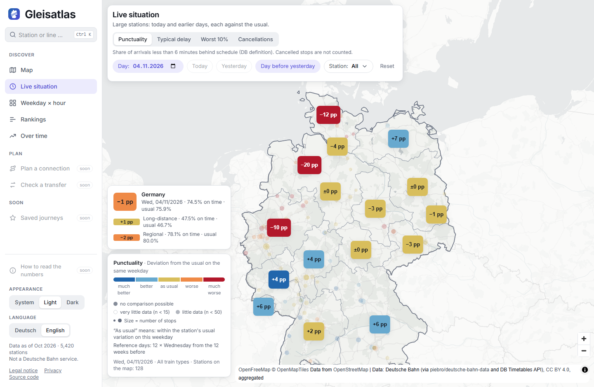
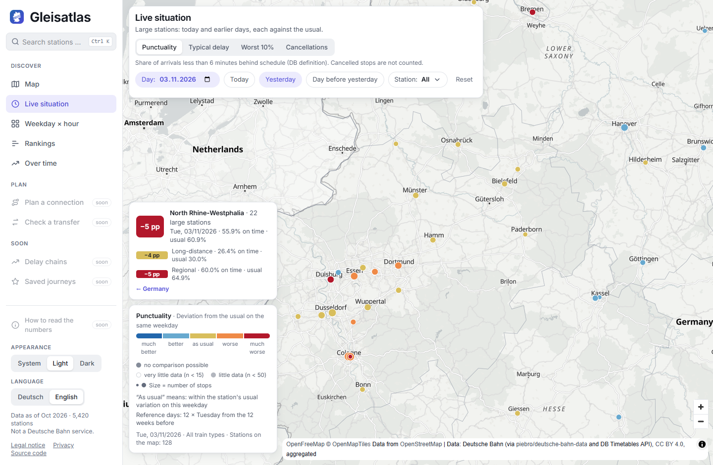
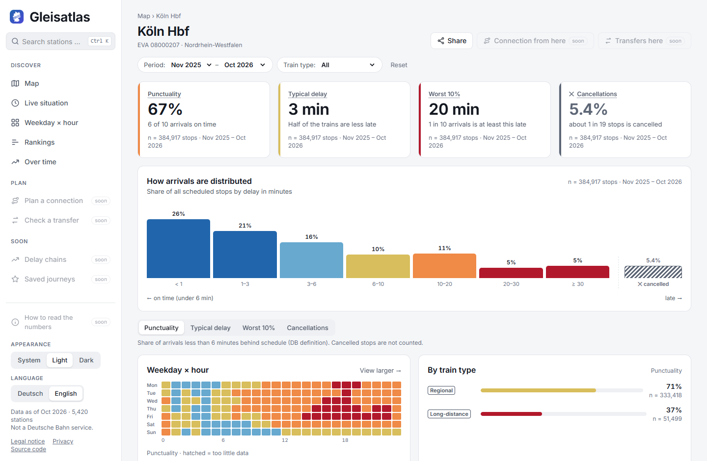
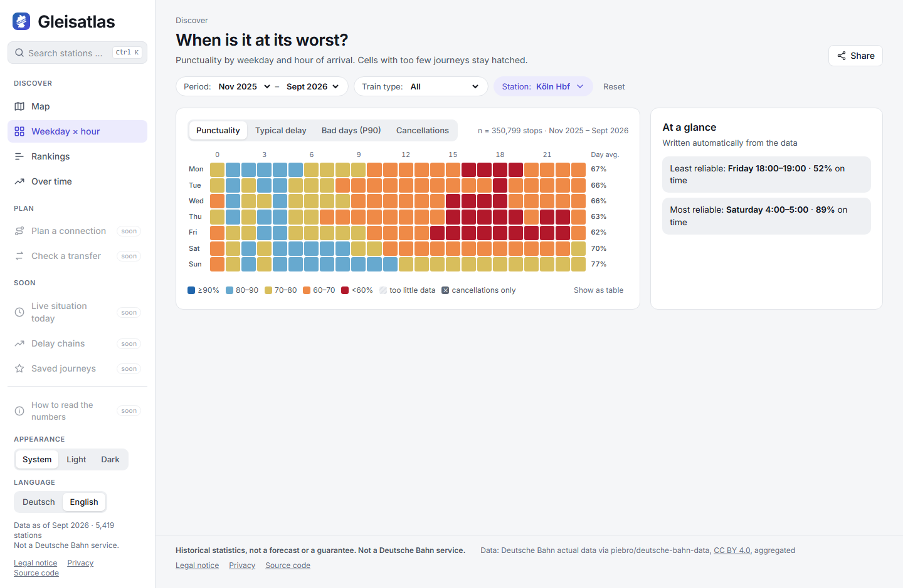
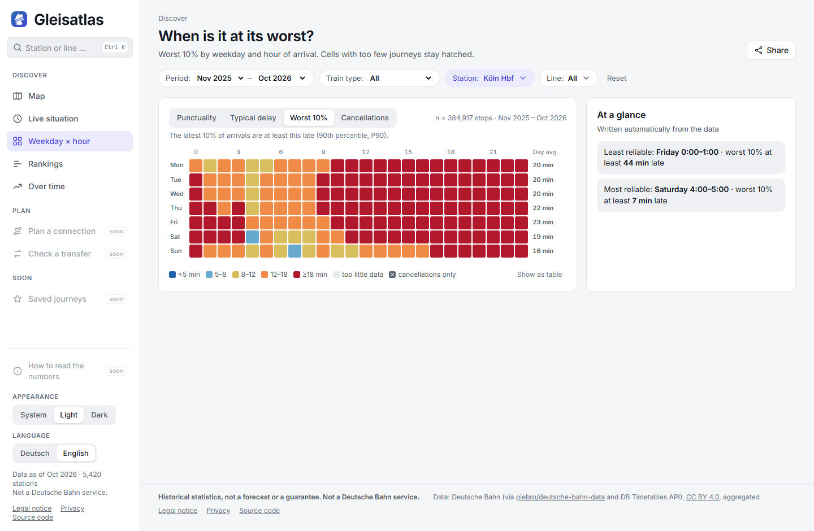
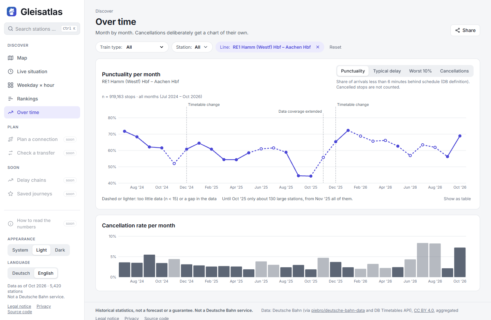
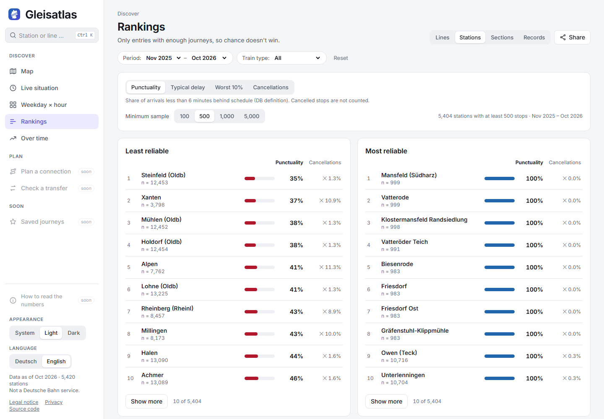

# 

[](https://github.com/EliasK93/gleisatlas/actions/workflows/gate.yml) [](https://github.com/EliasK93/gleisatlas/actions/workflows/gate.yml) [](LICENSE) 

Web app that shows the punctuality, typical delay, the worst 10% of arrivals and cancellations of German rail traffic by station, line, weekday and hour, since July 2024 and up to the last complete day. The data is Deutsche Bahn's, from the [DB Timetables API](https://developers.deutschebahn.com/db-api-marketplace/apis/product/timetables): the history from the archive [piebro/deutsche-bahn-data](https://huggingface.co/datasets/piebro/deutsche-bahn-data), the data of the current day optionally straight from the Timetables API. It is aggregated with [Python](https://www.python.org) and [Polars](https://pola.rs) and served by [FastAPI](https://fastapi.tiangolo.com). The UI is built with [React](https://react.dev), [TypeScript](https://www.typescriptlang.org), [Vite](https://vite.dev), [Tailwind](https://tailwindcss.com) and [MapLibre](https://maplibre.org), and is set up for Azure. It reads in German or English, in a light or a dark theme. Historical statistics, no forecast or guarantee. Not a Deutsche Bahn service. The data is under CC BY 4.0.

<table>
<tr>
<td align="center" valign="top" width="50%"><p><b>Map</b></p><br>Every station as a dot, coloured by punctuality and sized by the number of stops, on a map of Germany.</td>
<td align="center" valign="top" width="50%"><p><b>Map (dark) with a station</b></p><br>A click on a dot opens the station's key figures in a panel next to the map, here in the dark theme.</td>
</tr>
<tr>
<td align="center" valign="top" width="50%"><p><b>Map for a range of days</b></p><br>Any range of days up to the last complete one, set with two date fields, here 10th to 31st October 2026.</td>
<td align="center" valign="top" width="50%"><p><b>Live situation</b></p><br>One day against the usual for that weekday: a card for each of the 16 federal states and one for Germany.</td>
</tr>
<tr>
<td align="center" valign="top" width="50%"><p><b>A federal state</b></p><br>A click on a state zooms in and opens its card, with long-distance and regional trains shown apart.</td>
<td align="center" valign="top" width="50%"><p><b>Station</b></p><br>Key figures, delay distribution, weekday × hour pattern, and long-distance and regional trains side by side.</td>
</tr>
<tr>
<td align="center" valign="top" width="50%"><p><b>Weekday × hour</b></p><br>When trains are least punctual, by weekday and hour, for one station or for all of them together.</td>
<td align="center" valign="top" width="50%"><p><b>Four metrics, one switch</b></p><br>Punctuality, typical delay, worst 10% and cancellations: the same switch on every page of the app.</td>
</tr>
<tr>
<td align="center" valign="top" width="50%"><p><b>Over time</b></p><br>Month by month for a line, here the RE1, with timetable changes marked. Network and stations also by day.</td>
<td align="center" valign="top" width="50%"><p><b>Rankings</b></p><br>The least and most reliable stations or lines, with a minimum sample so that chance does not win.</td>
</tr>
</table>

## Features

- **Map**: about 5,400 stations on a map of Germany, coloured by punctuality, typical delay, worst 10% (P90) or cancellations, for any range of days up to the last complete one (two date fields).
- **Live situation**: the 131 large stations for one day, today so far against the same hours of the usual days (the same weekday over the 12 weeks before), or any past day back to 2024-07. The 16 federal states show their deviation from the usual as a card and an area, Germany as a card, every station as a dot. Today comes from its own collector for the DB Timetables API (optional, see below). Without the collector, today comes from the raw data that [piebro/deutsche-bahn-data](https://huggingface.co/datasets/piebro/deutsche-bahn-data) has already published for the day, which is partial and up to about 10 hours behind.
- **Four metrics on every page**: one switch for punctuality, typical delay, worst 10% and cancellations. The choice stays when the page changes.
- **Station page**: key figures, the delay distribution, the weekday × hour pattern, long-distance and regional trains side by side, the lines at the station and a sparkline by month.
- **Weekday × hour heatmap**: when trains are least and most punctual, with a short summary.
- **Rankings**: stations or lines, worst and best, with a minimum sample so that chance doesn't win.
- **Time series**: day by day with a trend, or monthly as a switch (lines are monthly). Timetable changes and gaps in the data are marked.
- **Filters in the URL**: period, category (regional or long-distance), station and metric live in the link, so a shared link opens the same view.
- **Station search**: Ctrl+K jumps to the search field.
- **German or English, light or dark**: the language follows the browser on the first visit. The theme follows the system or a fixed choice.

## How it was developed with Claude Code

The project was built with Claude Code. The rules it works by are in [CLAUDE.md](CLAUDE.md), and each feature has its spec, decisions and milestones in `docs/<feature>.md`.

- Every milestone starts in plan mode. The plan is approved before any code is written, and any decision with trade-offs goes back to the human as options.
- The main Claude Code session only orchestrates. The work is done by subagents: each gets a brief file with what to read, the files it may edit, the checks to run and a fixed reply line, and writes its result to a reply file that the orchestrator reads. Sonnet takes routine implementation and docs, Opus the harder design work and the reviews.
- Reviews are separate subagents with a fresh view: they get the diff and the plan, not the doer's conclusions. One of them uses [ponytail](https://github.com/DietrichGebert/ponytail) to look for over-engineering: the laziest version that passes the checks.
- [graphify](https://github.com/Graphify-Labs/graphify) keeps a knowledge graph of the code and docs for orientation.
- The check is written first, then the code. Pure logic lives in `core/` without framework imports and is unit-tested with [pytest](https://pytest.org). The API is tested through its routes and the screens with [Playwright](https://playwright.dev) on the real pages.
- The gate (`uv run python scripts/gate.py`) runs before every hand-off: [ruff](https://docs.astral.sh/ruff/), [pyright](https://microsoft.github.io/pyright/), pytest, the frontend's type check, [ESLint](https://eslint.org), [Prettier](https://prettier.io) and Playwright, the licence file, a [Bicep](https://learn.microsoft.com/azure/azure-resource-manager/bicep/) build and a [gitleaks](https://github.com/gitleaks/gitleaks) secret scan. It also runs as the git pre-commit hook, and the same gate runs on GitHub Actions for every push and pull request.
- Claude Code queues a batch of changes and hands the human one test round with a numbered checklist of what to open, what to do and what to see. Only after that test and a green gate does it commit, locally, and pushing is always done by the human.

## Run it locally

Needs [uv](https://docs.astral.sh/uv/) (it installs the Python version from `.python-version`), [Node.js](https://nodejs.org) 22 (CI uses 22.13.0) and git.

```sh
# install the dependencies
uv sync
npm --prefix frontend install

# build the data: the first run fetches the station coordinates and about 5 GB of train data and takes several minutes
uv run python -m pipeline.update

# start the API (first terminal)
uv run uvicorn backend.main:app --port 8317

# start the web app (second terminal), then open http://localhost:5317
npm --prefix frontend run dev
```

## Update the data

Optional fresher data for today on the Live situation page needs an application with the plan "Free" of the Timetables API in the [DB API Marketplace](https://developers.deutschebahn.com/db-api-marketplace/apis/product/timetables), with its client id and key in your environment as `DB_CLIENT_ID` and `DB_API_KEY`, never in the repository. Without the key the page works as well: today then comes from the raw data that [piebro/deutsche-bahn-data](https://huggingface.co/datasets/piebro/deutsche-bahn-data) has already published for the day, which is partial and up to about 10 hours behind.

```sh
# fetch the new months and days, for example once a day
uv run python -m pipeline.update

# refresh the station coordinates from Wikidata (rarely needed)
uv run python -m pipeline.coords

# collect live data for today at the 131 large stations (needs the key, run it every 15 minutes)
uv run python -m pipeline.live
```

## Deploy to Azure

The site is set up for Azure Static Web Apps (frontend), Container Apps (API) and Blob Storage (the aggregates), described in Bicep in `infra/main.bicep`.

## Development

Besides the tools above, the gate needs [gitleaks](https://github.com/gitleaks/gitleaks#installing) and the [Azure CLI](https://learn.microsoft.com/cli/azure/install-azure-cli). Neither needs a login.

```sh
# install the git hook that runs the gate before each commit (once after cloning)
uv run python scripts/install_hooks.py

# install the browser for the end-to-end tests (once)
npx --prefix frontend playwright install chromium

# install Bicep for the gate's Bicep build (once)
az bicep install --version v0.48.1

# run every check: it stages all changes first and fails if anything is left unstaged or untracked
uv run python scripts/gate.py

# fix the formatting and the licence file (the gate only checks them)
uv run python scripts/format.py

# regenerate backend/openapi.json and frontend/src/schema.d.ts after an API change (the gate fails when they are stale)
uv run python scripts/export_openapi.py
npm --prefix frontend run gen
```

Documentation:

- [SPEC.md](SPEC.md): product specification and acceptance criteria
- [docs/roadmap.md](docs/roadmap.md): milestones
- [docs/design.md](docs/design.md): design concept, with the mockup [docs/design/mockup.html](docs/design/mockup.html)
- [docs/pipeline.md](docs/pipeline.md): data pipeline
- [docs/deployment.md](docs/deployment.md): Azure resources and runbook

`docs/` has a doc for each further feature, and `docs/adr/` holds the architecture decisions.

## Licences

| Part | Source | Licence |
|---|---|---|
| Train data | Deutsche Bahn (DB Timetables API) via [piebro/deutsche-bahn-data](https://huggingface.co/datasets/piebro/deutsche-bahn-data), aggregated by Gleisatlas. `pipeline/raw.py` reimplements the rules of that project's monthly-release parser (MIT) to read its raw responses | [CC BY 4.0](https://creativecommons.org/licenses/by/4.0/) |
| Live data for today (optional) | DB Timetables API, called by `pipeline.live` with your own key, aggregated by Gleisatlas | [CC BY 4.0](https://creativecommons.org/licenses/by/4.0/) per the product page, and the [DB API Marketplace](https://developers.deutschebahn.com/db-api-marketplace/apis/nutzungsbedingungen) terms of use apply |
| Station coordinates and federal states | [Wikidata](https://www.wikidata.org) | CC0 |
| State shapes on the Live situation map | [Natural Earth](https://www.naturalearthdata.com) admin-1 boundaries, simplified | Public domain |
| Map tiles and style | © [OpenStreetMap](https://www.openstreetmap.org/copyright) contributors, [OpenMapTiles](https://openmaptiles.org), [OpenFreeMap](https://openfreemap.org) | OpenStreetMap data under ODbL, attribution on the map |
| Libraries in the web app | React, React DOM, React Router, TanStack Query, openapi-fetch, MapLibre GL JS, the Inter font | MIT, BSD-3-Clause, SIL OFL 1.1. The full texts are in [THIRD_PARTY_LICENSES.md](THIRD_PARTY_LICENSES.md), written by the production build, and on the site at `/licenses.txt` |
| Libraries of the API and the pipeline | Polars, FastAPI, uvicorn, and for the pipeline huggingface-hub (direct dependencies in [pyproject.toml](pyproject.toml)) | MIT, MIT, BSD-3-Clause, Apache-2.0 |
